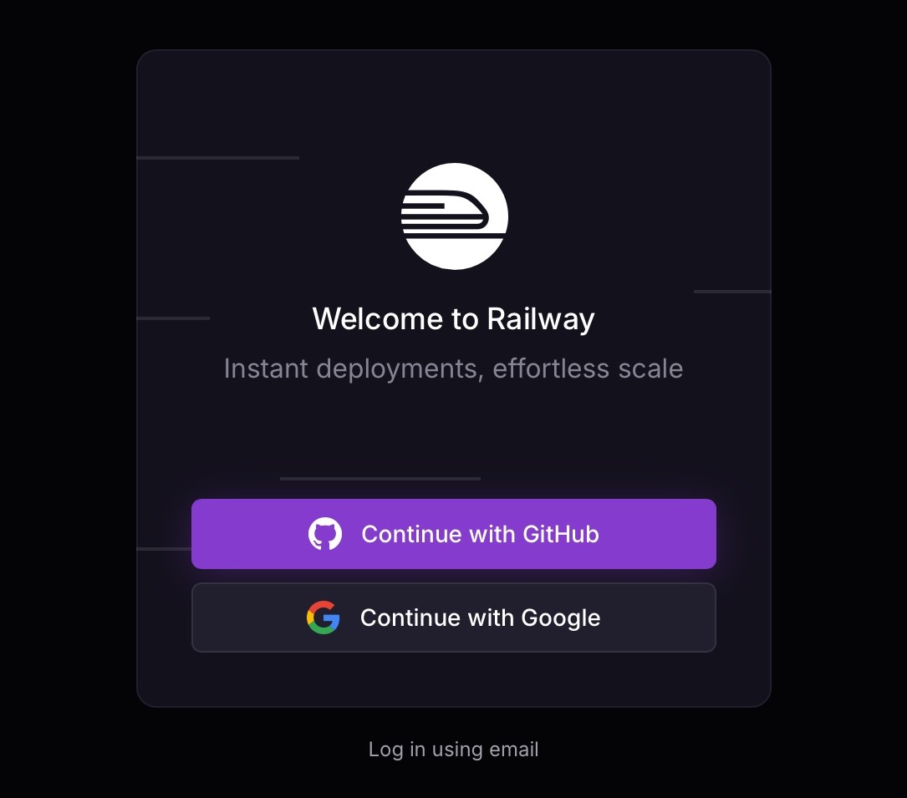
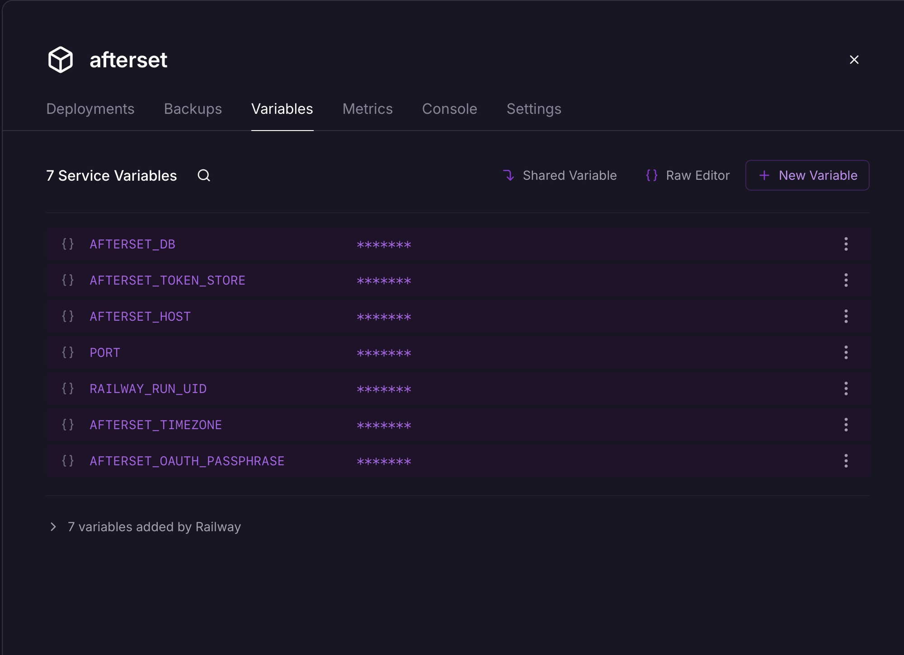
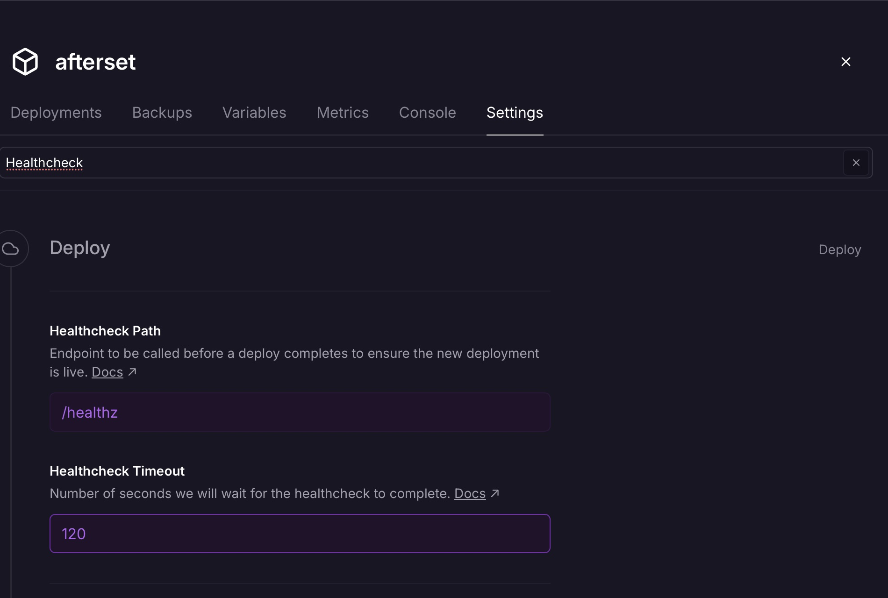
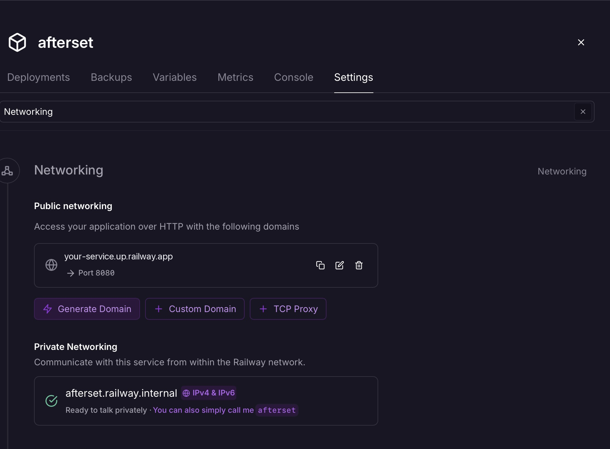

# Set up Afterset on Railway and use it from ChatGPT

[Documentation](../README.md)

Deploy Afterset on Railway, log in to Garmin, and connect ChatGPT. Railway keeps
your Afterset server available when your computer is off.

You need a Garmin account, a Railway account, and a ChatGPT account with access
to **Add custom MCP server**. Your installation stores its training records and
Garmin session on your Railway volume.

## 1. Sign in to Railway

Open [Railway](https://railway.com/dashboard), sign in, and complete any account
verification. Review the hosting plan before creating your project.



## 2. Create the Afterset service

Copy the image reference from [GitHub Releases](https://github.com/oglu/afterset/releases).
Choose **New → Docker Image** and paste that reference.

Leave registry credentials empty and choose **Deploy Image**. Open the new
`afterset` service to configure it.

## 3. Attach persistent storage

From the project canvas, choose **Add → Volume**, select the `afterset` service,
and set the mount path to:

```text
/data
```

This volume keeps your records, your Garmin session and any personal context
across deployments. Keep one
replica and the image's default start command. Finish the configuration below
before applying the staged changes.

## 4. Configure the service

Open **Variables → Raw Editor → ENV** and paste:

```dotenv
AFTERSET_DB=/data/afterset.db
AFTERSET_TOKEN_STORE=/data/garmin_tokens
AFTERSET_HOST=0.0.0.0
PORT=8080
RAILWAY_RUN_UID=0
AFTERSET_TIMEZONE=Europe/London
```

Change `Europe/London` to your timezone if needed, then choose **Update Variables**.

Add a **New Variable** named `AFTERSET_OAUTH_PASSPHRASE`. Use a private passphrase
of at least 16 characters and save it in your password manager. You will enter
this passphrase when connecting ChatGPT in step 7.



In **Settings**, configure:

| Setting | Value |
| --- | --- |
| Replicas | `1` |
| Healthcheck path | `/healthz` |
| Healthcheck timeout | `120` seconds |
| Restart policy | On Failure, up to `5` retries |
| Deployment overlap | `0` seconds |
| Draining | `0` seconds |
| Required volume mount, if available | `/data` |

Use **Filter Settings** to find Healthcheck and Restart, saving each setting.
Under **Teardown**, enable the setting and set draining to `0`.



## 5. Generate the address and deploy

Open **Settings → Networking → Generate Domain** and use target port `8080`.



Click **Deploy** to apply the staged changes. Wait for **Deployment successful**.

Copy your generated domain and add `/mcp`. Save this address for step 7:

```text
https://YOUR-DOMAIN/mcp
```

Use the domain from your own Railway service; screenshots show an example
installation.

## 6. Log in to Garmin

1. Open your Railway **Afterset service → Console** and wait for **Connected**.
2. Click inside the terminal and run:

   ```sh
   /opt/venv/bin/afterset login
   ```

3. Enter your Garmin email and press **Return**, then enter your Garmin password
   and press **Return**. Both prompts hide what you type. Complete MFA if Garmin
   requests a code.
4. Wait for:

   ```text
   Garmin session saved. Password was not saved; no training records were changed.
   ```

Afterset saves the session on your persistent Railway volume. Your Garmin
password is not saved. You normally complete this login once; session renewal
is automatic.

## 7. Connect ChatGPT

On ChatGPT web, using the account you use on your phone:

1. Open **Plugins → + → Add custom MCP server**.
2. Name it **Afterset**, enter your saved HTTPS `/mcp` address, and select
   **OAuth**. Leave the other connection settings at their defaults.
3. Review the warning, select **I understand and want to continue**, and choose
   **Create as a plugin**.
4. Choose **Connect Afterset**. On the Afterset page, enter the
   `AFTERSET_OAUTH_PASSPHRASE` you saved in step 4. Review the access requested,
   including personal context such as illness and life events, then choose **Allow access**.
5. Install the resulting private plugin if prompted.

ChatGPT should now show your Afterset account under **Connected accounts**.

These steps follow the official [ChatGPT connection instructions](https://developers.openai.com/plugins/deploy/connect-chatgpt).

## 8. Sync and use Afterset from your phone

Open ChatGPT with the same account/workspace, start a new chat, and type `@` to
select **Afterset**. Ask:

> Sync my Garmin wellness and activities for the last seven days, including
> activity details. Wait for both sync jobs to finish and report any failures.

Then ask:

> Check my Afterset data coverage and summarize my training this week.

Login connects Garmin; this first sync imports your records. Request another
sync whenever you want to bring in new workouts and recovery data.
